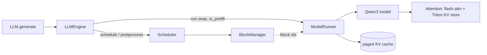
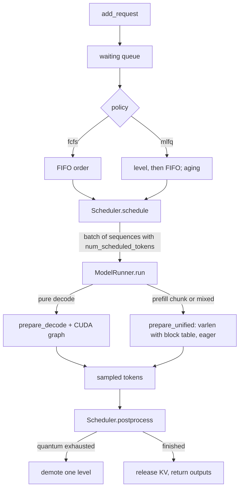
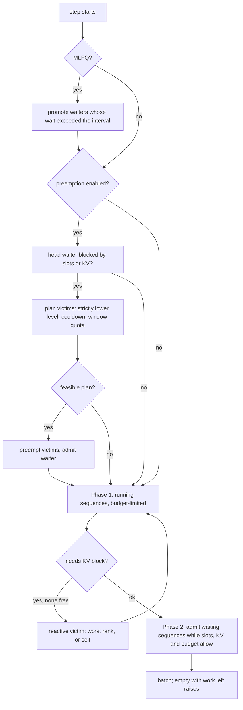
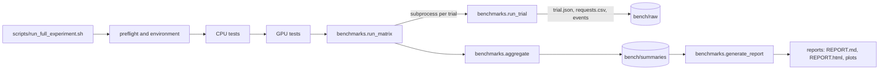

# Architecture

## Original nano-vLLM (V0)

The scheduler returns a prefill batch or a decode batch, never both. See [SCHEDULER_MODERNIZATION.md](SCHEDULER_MODERNIZATION.md) for what changed.

## Modernized engine (V1 and V2)

| Module | Responsibility |
|---|---|
| `engine/scheduler.py` | token-budget batching, admission, reactive and proactive preemption, stats, events |
| `engine/mlfq.py` | feedback state, quanta, demotion, aging, first-token promotion (no torch) |
| `engine/block_manager.py` | KV blocks, prefix cache, release-planning helpers |
| `engine/sequence.py` | request state, feedback record, tensor-parallel serialization |
| `engine/model_runner.py` | batch preparation (decode, unified) and model execution |
| `engine/llm_engine.py` | step loop, `StepResult`, `generate`, `cancel_request` |
| `config.py` | all scheduler and MLFQ knobs; validated at construction |

## Scheduler decision flow

## Invariants and where they are tested

- Token budget and slot limits: scheduler, property tests.
- KV reference counts equal owners; no double free: `tests/helpers.assert_kv_invariants`, called after each step.
- Completion tokens never lost or regenerated after preemption: property tests.
- Aging bounded and non-skipping: `tests/test_mlfq.py`.

## Benchmark pipeline

See [BENCHMARKING.md](BENCHMARKING.md).
