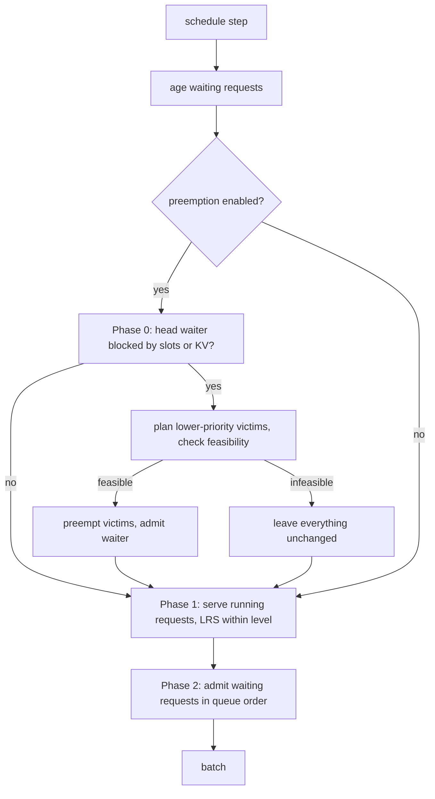

# Four-level MLFQ scheduling

Selected with `LLM(..., scheduling_policy="mlfq")`. Implemented in `nanovllm/engine/mlfq.py` (policy state) and `nanovllm/engine/scheduler.py` (decisions). The policy never touches tensors.

## Levels

| Level | Name | Prefill allowance | Decode allowance |
|---|---|---:|---:|
| Q0 | highest | 512 tokens | 16 tokens |
| Q1 | high | 1024 tokens | 48 tokens |
| Q2 | normal | 2048 tokens | 192 tokens |
| Q3 | lowest | none (never demotes) | none |

These are **initial experimental defaults**, not validated optimal values. They are configurable: `mlfq_prefill_quanta`, `mlfq_decode_quanta` (three values each, for Q0–Q2).

Priority reflects feedback, not an application category. Every new request enters Q0.

## Service accounting

Each computed token is charged exactly once:

- A **pure decode step** (one token generated) adds 1 to `decode_service`.
- Any other step adds the number of prompt or recomputed tokens it computed to `prefill_service`.

The level has its own counters. A request is demoted when its counter for the current level reaches that level's allowance. On demotion both counters reset, and lifetime totals are kept for reporting. Demotion never forcibly preempts a running request: it keeps running if resources allow, and only its queue position changes if it is waiting.

When prefill ends and decode starts, the level is **not** reset. Feedback history is preserved.

Optional `mlfq_first_token_promotion` (off by default, tested) moves a request to Q0 when its first output token is produced.

## Queue order

Waiting requests are sorted by `(level, queue_seq)`. `queue_seq` is updated on arrival, on preemption, and on every level change, so ordering within a level is FIFO by the time a request joined that queue.

Running requests are served least-recently-served first within a level.

## Aging (starvation prevention)

A waiting request is promoted one level for every `mlfq_aging_interval` seconds of continuous waiting (default 5 s). The wait clock restarts on each promotion, so a request climbs at most one level per interval and cannot skip levels in one step. Preempted requests age while they wait, because their wait clock restarts when they are preempted.

Time is measured with `time.monotonic` through an injectable clock, so tests use a fake clock.

Tests show that a Q3 request is admitted within a bounded number of steps when fresh Q0 requests keep arriving (`test_aging_prevents_starvation_under_repeated_short_arrivals`). The same workload with aging disabled never admits it (`test_without_aging_the_long_request_is_starved`).

## Admission under contention

With no resource pressure, MLFQ admits in queue order and never evicts. See [PREEMPTION.md](PREEMPTION.md) for the cases where it does evict.

## Per-request metadata

`Sequence.feedback` (`FeedbackState`) holds: level, level and lifetime prefill/decode service, queue position, `waiting_since` (monotonic), `last_scheduled_step`, `admitted_step`, `admit_order`, `cooldown_until_step`, `preemptions`, recent proactive-preemption steps, and the aging and demotion histories.
