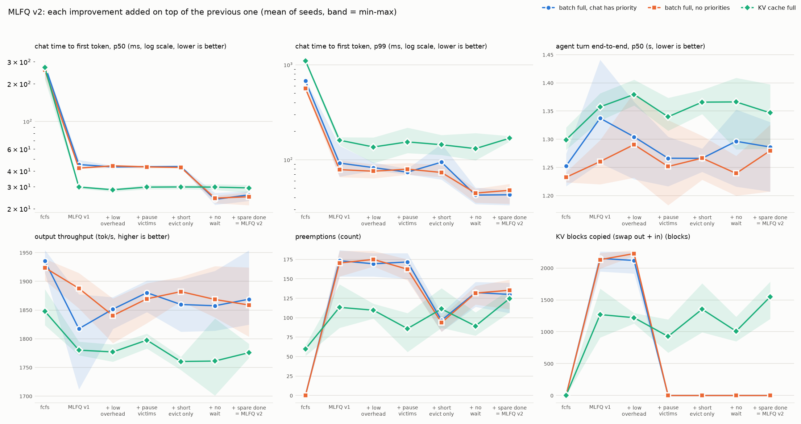
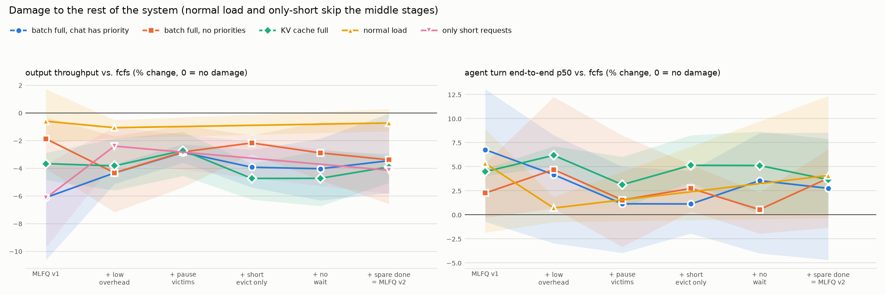
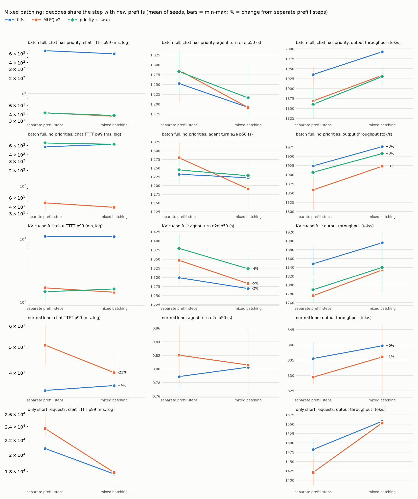
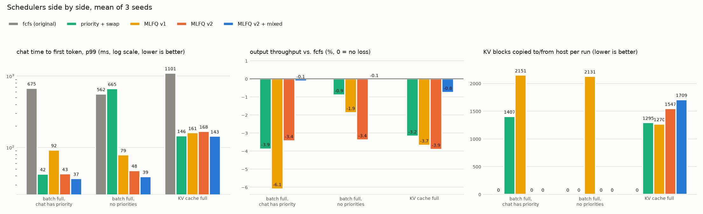
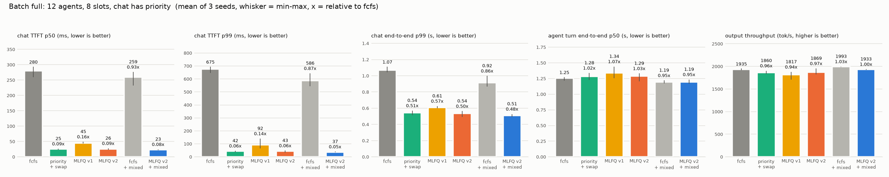
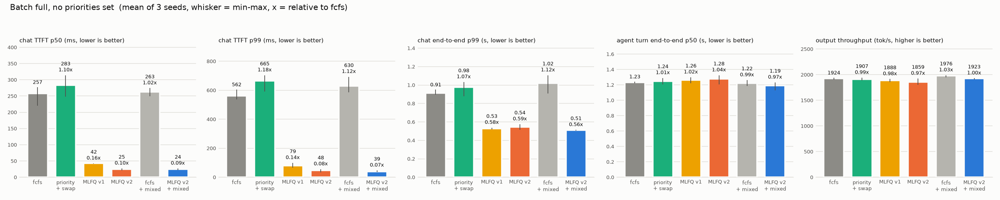
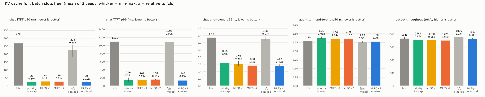
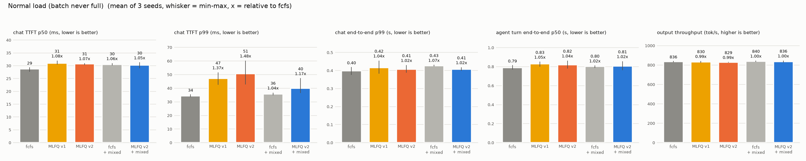
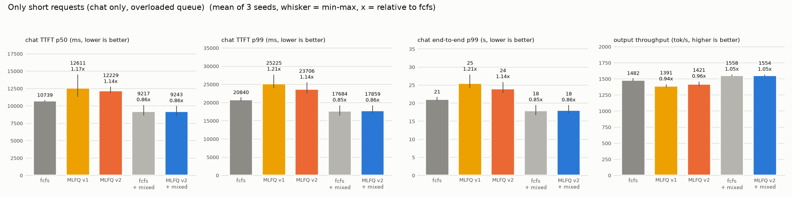

# Saturation-triggered MLFQ scheduling

nano-vllm's scheduler is first-come-first-served continuous batching. That is the right
policy almost all of the time: while there are free batch slots and free KV blocks every
request is admitted as soon as it arrives, and there is nothing to reorder.

It goes wrong in one situation, described in
[vllm-project/vllm#40004](https://github.com/vllm-project/vllm/issues/40004): the batch is
full (`max_num_seqs` sequences running) and the running sequences are long, low-value work
such as agent sessions generating thousands of tokens. A new interactive request now waits
until one of them finishes, which can be minutes. Sorting the waiting queue by priority does
not help, because the request is already first in line; there is simply no slot.

This branch keeps fcfs behaviour under normal conditions and switches to a multi-level
feedback queue (MLFQ) only once the batch is saturated.

## Policies

`scheduling_policy` selects one of:

| policy | rank (lower is better) | notes |
|---|---|---|
| `fcfs` (default) | arrival order | nano-vllm's original scheduler |
| `priority` | `priority` | strict tiers, `starvation_steps` boosts long-waiting requests one tier |
| `mlfq` | `(level, priority)` | the policy this document is about |

All three cap `running` at `max_num_seqs`, as vLLM does. (Upstream nano-vllm only caps
the number of sequences per step, so extra sequences could sit in `running` holding KV
without being decoded.)

## When does it preempt?

| situation | what happens |
|---|---|
| free slots, free KV | nothing; requests are admitted best rank first |
| free slots, KV full at admission | the request waits, exactly like fcfs |
| **batch full** and a waiting request ranks strictly better than a runner | after `preempt_after_steps` steps of waiting, the worst-ranked runners are evicted, just enough to free one slot and the newcomer's KV blocks. All or nothing |
| KV full during decode | as in fcfs (and vLLM), one runner is evicted; here it is the worst-ranked one instead of the newest |

Guards against churn: equal ranks never evict each other, a runner is protected for its
first `min_resident_steps` decode steps, sequences already in the current step's batch are
never evicted, and nobody is evicted for a newcomer that would not fit anyway.

## MLFQ

Four levels by default, set by `mlfq_level_tokens=(1024, 4096, 8192)`. The level follows a
request's size, prompt plus generated tokens:

| level | holds |
|---|---|
| 0 | up to 1024 tokens |
| 1 | up to 4096 |
| 2 | up to 8192 |
| 3 | everything longer |

* New requests go in by size: a short chat starts at level 0, a 5000-token prompt at level 2.
* While the batch has room, levels change nothing. A request that grows past 1024 tokens
  keeps running exactly as in fcfs.
* Once the batch is full and new requests keep coming, a newcomer evicts the runner in the
  lowest level (the longest one), so long agent sessions make way for short requests. With
  swap the evicted request keeps its KV cache in host memory.
* Aging: a waiting request moves up one level every `aging_steps` scheduler steps, and a
  promoted request gets that level's whole token band again before it can drop. When the
  batch has free slots, waiting requests are admitted best level first, so evicted ones
  come back as soon as there is room.
* Priorities are optional. `SamplingParams.priority` breaks ties within a level;
  `mlfq_priority_scale` widens the bands of important requests (scale 2 lets priority -1
  hold 2048 tokens in level 0); `mlfq_max_levels={0: 1}` keeps priority 0 at level 1 or above.

Because it uses only the size it can see, MLFQ needs no output-length prediction and no
priorities: it already tells a short chat from a 6000-token agent context.

## Preemption: recompute or swap

`preemption_mode`:

* `recompute`: drop the victim's KV blocks; it re-prefills when resumed (prefix caching may
  save part of it).
* `swap`: copy the victim's KV blocks into a pinned host-memory pool of `swap_space` GiB and
  copy them back on resume. The copies are queued on the compute stream before the forward
  pass, so they are ordered against it without extra synchronization. Falls back to
  recompute if the pool is full.
* `auto`: swap only victims with at least `swap_min_tokens` cached tokens. Short contexts
  are about as cheap to recompute as to copy, so host memory is kept for long agent
  contexts, which are the usual victims.

## Recommended configuration

MLFQ v2 (see [below](#mlfq-v2-preemption-that-costs-almost-nothing)):

```python
LLM(model, scheduling_policy="mlfq", mlfq_level_tokens=(1024, 4096, 8192),
    aging_steps=200, min_resident_steps=4, preempt_after_steps=0,
    preemption_mode="auto", swap_space=4, swap_min_tokens=256,
    pause_victims=True, mlfq_preempt_max_level=0, preempt_min_remaining_tokens=16)
llm.generate(prompts, SamplingParams(priority=0))    # lower value = more important
```

For the lowest cost add `mixed_batching=True` (see [Mixed batching](#mixed-batching)).

All new options default to off, and `scheduling_policy="fcfs"` (the default) never
reaches any of the new code, so nano-vllm's original behaviour is unchanged unless MLFQ is
asked for.

## MLFQ v2: preemption that costs (almost) nothing

The first version (v1, the results in the next section) already cut chat latency about 9x
once the batch was full, but it paid for it: 2-6% throughput and 3-7% slower agent turns. Looking at where that cost came from gave five separate causes, and each has a fix
that removes the cost without giving up the latency win.

| # | cause in v1 | fix in v2 | option |
|---|---|---|---|
| 1 | With a long queue, every scheduler step re-sorted the whole waiting queue and walked it once to age every request. With 500 requests waiting that is 109 us of Python per step against 5 us for fcfs, several percent of a 3-4 ms decode step. It even showed up with **no preemption at all**. | Re-sort only when the order can actually have changed (a newcomer ranks ahead of the tail, a preemption, an aging promotion). Aging uses one global step counter and files each request under the step it is next due, so a step only touches the requests that age on it. 15 us per step. Decisions are identical to v1 (checked step by step on 300 random workloads). | always on |
| 2 | Every eviction copied the victim's whole KV cache to host memory and back (about 2k tokens per agent), even though the batch-full case has **plenty of free GPU KV**: only the batch slot was short. The copies are queued on the compute stream, so they delay the forward pass. | **Pause** the victim instead: it leaves the batch but keeps its KV blocks on the GPU, and resumes with no copy and no recompute. Its blocks are only swapped out (or dropped) if something actually needs them: a newcomer that would not fit otherwise, a decode step that runs out of blocks, or a swap-in. Idle paused blocks are always taken before a running sequence is evicted. | `pause_victims=True` |
| 3 | Any request of strictly better rank could evict. A new agent turn at level 1 evicted an agent at level 3, and an evicted agent that aged back up evicted another agent: one long request swapped for another, no latency gained for anyone, a copy paid each time. | Only **fresh short requests** evict: a request that has never been preempted and is in level 0. Everyone else still gets the best free slot, but never takes one by force. | `mlfq_preempt_max_level=0` |
| 4 | A newcomer waited `preempt_after_steps=8` steps before evicting, in case a slot freed up on its own. With agents holding all slots that rarely happens within 8 steps, so it mostly added about 20 ms to every chat request. | No wait. Churn is still prevented by `min_resident_steps`, and with pausing an eviction is cheap anyway. | `preempt_after_steps=0` |
| 5 | A runner a few tokens from its end could be evicted, paying the eviction and the resume to save almost nothing. This is also the request that crosses a level boundary just before it finishes. | Runners with fewer than 16 tokens left before `max_tokens` are never evicted for a newcomer. | `preempt_min_remaining_tokens=16` |

What stays the same: while the batch has free slots nothing is ever preempted; equal ranks never
evict each other; a request that does not fit in the KV cache waits exactly as in fcfs; when
the KV cache, not the batch, is full, the worst-ranked sequence is still the one evicted.

**Only short requests.** If every request is short, they all sit in level 0 with the same rank,
and the strictly-better-rank rule means nobody can evict anybody: MLFQ admits in arrival order,
exactly like fcfs, with zero preemptions. The `all-short` scenario below checks this.

### MLFQ v2 results

Same machine, model and workload as below, 45 s of arrivals per run, **3 seeds per
configuration** (the v1 results further down are single runs). `GPU=3 V1_TREE=... scripts/run_mlfq_v2_bench.sh all`;
raw numbers in `results/mlfq_v2_bench.jsonl`, charts and table from `python -m benchmarks.plot_ablation`.
"MLFQ v1" runs the original v1 code; every column after it adds one improvement on top of the
previous one, so each step of a line is the effect of one fix. `all-short` is open-loop chat only
(40 requests/s into 8 slots, more than the GPU can serve, so the queue keeps growing).





Mean of 3 seeds:

| scenario | config | chat TTFT p50 | chat TTFT p99 | chat e2e p99 | agent e2e p50 | tok/s | preempt | paused | swapped out |
|---|---|---|---|---|---|---|---|---|---|
| batch-cap | fcfs | 280 ms | 675 ms | 1.07 s | 1.25 s | 1935 | 0 | 0 | 0 |
| batch-cap | priority-swap | 25 ms | 42 ms | 0.54 s | 1.28 s | 1860 | 135 | 0 | 135 |
| batch-cap | mlfq-v1 | 45 ms | 92 ms | 0.61 s | 1.34 s | 1817 | 173 | 0 | 173 |
| batch-cap | +low-overhead | 43 ms | 82 ms | 0.56 s | 1.30 s | 1852 | 169 | 0 | 169 |
| batch-cap | +pause | 43 ms | 74 ms | 0.55 s | 1.27 s | 1880 | 172 | 172 | 0 |
| batch-cap | +short-only | 44 ms | 94 ms | 0.55 s | 1.27 s | 1860 | 97 | 97 | 0 |
| batch-cap | +no-wait | 24 ms | 42 ms | 0.52 s | 1.30 s | 1857 | 132 | 132 | 0 |
| batch-cap | **mlfq-v2** | **26 ms** | **43 ms** | 0.54 s | 1.29 s | 1869 | 130 | 130 | **0** |
| no-priority | fcfs | 257 ms | 562 ms | 0.91 s | 1.23 s | 1924 | 0 | 0 | 0 |
| no-priority | priority-swap | 283 ms | 665 ms | 0.98 s | 1.24 s | 1907 | 0 | 0 | 0 |
| no-priority | mlfq-v1 | 42 ms | 79 ms | 0.53 s | 1.26 s | 1888 | 170 | 0 | 170 |
| no-priority | +low-overhead | 44 ms | 76 ms | 0.55 s | 1.29 s | 1840 | 175 | 0 | 175 |
| no-priority | +pause | 43 ms | 79 ms | 0.54 s | 1.25 s | 1870 | 162 | 162 | 0 |
| no-priority | +short-only | 43 ms | 73 ms | 0.54 s | 1.27 s | 1882 | 94 | 94 | 0 |
| no-priority | +no-wait | 24 ms | 44 ms | 0.53 s | 1.24 s | 1868 | 132 | 132 | 0 |
| no-priority | **mlfq-v2** | **25 ms** | **48 ms** | 0.54 s | 1.28 s | 1859 | 135 | 135 | **0** |
| kv-pressure | fcfs | 270 ms | 1101 ms | 1.35 s | 1.30 s | 1848 | 60 | 0 | 0 |
| kv-pressure | priority-swap | 28 ms | 146 ms | 0.65 s | 1.38 s | 1789 | 133 | 0 | 133 |
| kv-pressure | mlfq-v1 | 30 ms | 161 ms | 0.61 s | 1.36 s | 1780 | 113 | 0 | 113 |
| kv-pressure | mlfq-v2 | 29 ms | 168 ms | 0.58 s | 1.35 s | 1776 | 125 | 0 | 125 |
| normal | fcfs | 29 ms | 34 ms | 0.40 s | 0.79 s | 836 | 0 | 0 | 0 |
| normal | mlfq-v1 | 31 ms | 47 ms | 0.42 s | 0.83 s | 830 | 0 | 0 | 0 |
| normal | mlfq-v2 | 31 ms | 51 ms | 0.41 s | 0.82 s | 829 | 0 | 0 | 0 |
| all-short | fcfs | 10.7 s | 20.8 s | 21.1 s | - | 1482 | 0 | 0 | 0 |
| all-short | mlfq-v1 | 12.6 s | 25.2 s | 25.5 s | - | 1391 | 0 | 0 | 0 |
| all-short | +low-overhead | 11.9 s | 22.4 s | 22.7 s | - | 1447 | 0 | 0 | 0 |
| all-short | mlfq-v2 | 12.2 s | 23.7 s | 24.0 s | - | 1421 | 0 | 0 | 0 |

(The middle kv-pressure stages are in the JSONL; with free slots they change nothing there.)

What each step did, as measured:

* **Low-overhead queue**: with a long queue (`all-short`) v1 lost 6.1% throughput to fcfs while
  making the same decisions (step counts within 0.2% of fcfs); the fix brings that to 2.4%.
* **Pause**: every KV copy is gone (about 170 swap-outs and as many swap-ins per run, 0 now) and
  throughput goes up about 1.5% in both batch-full scenarios; agent turns get slightly faster.
* **Only short newcomers evict**: 44% fewer preemptions (172 -> 97) for the same chat latency;
  the removed ones were agents evicting agents.
* **No wait**: chat TTFT p50 44 -> 24 ms and p99 about 80 -> 43 ms, for no measurable throughput
  (1860 -> 1857 tok/s; with pausing an eviction is cheap, so waiting bought nothing).
* **Spare nearly finished runners**: neutral here, as expected (few chats are evicted within 16
  tokens of their end); it only guards the boundary case.

Net, with the batch full: **MLFQ v2 gets chat in as fast as strict priority scheduling (p99 43
vs 42 ms, 16x better than fcfs), also when no priorities are set at all (48 ms, where priority
scheduling is no better than fcfs), with no KV copying, 3% slower agent turns (v1: 7%) and 3.4%
less throughput than fcfs (v1: 6.1% in batch-cap).** Without saturation (normal load, only-short
requests) it never preempts. Under KV pressure v2 behaves like v1: with free slots there is no
admission preemption, and decode-time evictions still have to swap.

**Open question.** In `all-short` MLFQ makes the same decisions and runs the same number of
steps as fcfs (within 0.2%), yet is 2-4% slower. Its scheduler costs only about 8 us more per step than fcfs
on that workload, roughly 0.15% of a 5.5 ms step, so the gap is not scheduler CPU time; the root
cause is not identified. It disappears with mixed batching (below): there MLFQ v2 runs at 1554
vs 1558 tok/s for fcfs, with the same run order, and priority-swap, which pins the same 4 GiB of
swap space as MLFQ, also matches fcfs (1555), so neither run order nor the pinned memory is it.


## Results

One H100 PCIe, Qwen3-0.6B, `GPU=3 scripts/run_priority_bench.sh all` (60 s of arrivals per run,
CUDA graphs on). Raw numbers are in `results/priority_bench.jsonl`; regenerate the charts with
`python -m benchmarks.plot`.

Workload (`benchmarks/priority_bench.py`): closed-loop agent sessions (300-600 token start,
128-384 tokens generated per turn, a 50-150 token tool result appended, reset at 2048 tokens,
priority 1) plus open-loop Poisson chat (32-128 token prompts, 16-128 tokens out, priority 0).
The benchmark uses smaller MLFQ levels to match: `mlfq_level_tokens=(256, 512, 1024)`, so chat
always stays in level 0 and agents sit in levels 1-3.

| scenario | setup |
|---|---|
| normal | 32 slots, 4 agents, 1 chat/s: the batch never fills |
| batch-cap | 8 slots, 12 agents, 4 chat/s, plenty of KV: the vllm#40004 case |
| no-priority | as batch-cap, but chat and agents have the same priority |
| kv-pressure | 64 slots but only 40 KV blocks (10k tokens) |

`mlfq` is the recommended configuration below with the smaller levels, swap for contexts of
128+ tokens.


| config | chat TTFT p50 | chat TTFT p99 | chat e2e p99 | agent e2e p50 | agent turns | tok/s | preempt | swap out/in | recomputed tok |
|---|---|---|---|---|---|---|---|---|---|
| normal/fcfs | 26 ms | 32 ms | 0.36 s | 0.73 s | 192 | 834 | 0 | 0/0 | 0 |
| normal/priority-recompute | 26 ms | 33 ms | 0.39 s | 0.79 s | 187 | 831 | 0 | 0/0 | 0 |
| normal/priority-swap | 26 ms | 41 ms | 0.39 s | 0.78 s | 186 | 838 | 0 | 0/0 | 0 |
| normal/mlfq | 26 ms | 36 ms | 0.39 s | 0.77 s | 187 | 827 | 0 | 0/0 | 0 |
| batch-cap/fcfs | 223 ms | 664 ms | 0.95 s | 1.16 s | 430 | 1952 | 0 | 0/0 | 0 |
| batch-cap/priority-recompute | 22 ms | 36 ms | 0.63 s | 1.41 s | 370 | 1733 | 187 | 0/0 | 233795 |
| batch-cap/priority-swap | 22 ms | 43 ms | 0.53 s | 1.27 s | 404 | 1853 | 180 | 180/180 | 0 |
| batch-cap/mlfq | 42 ms | 70 ms | 0.57 s | 1.28 s | 406 | 1887 | 218 | 218/218 | 0 |
| no-priority/fcfs | 259 ms | 649 ms | 1.10 s | 1.20 s | 423 | 1901 | 0 | 0/0 | 0 |
| no-priority/priority-recompute | 239 ms | 592 ms | 0.94 s | 1.22 s | 420 | 1916 | 0 | 0/0 | 0 |
| no-priority/priority-swap | 271 ms | 659 ms | 1.05 s | 1.24 s | 416 | 1924 | 0 | 0/0 | 0 |
| no-priority/mlfq | 43 ms | 74 ms | 0.57 s | 1.32 s | 394 | 1880 | 229 | 229/229 | 0 |
| kv-pressure/fcfs | 228 ms | 1052 ms | 1.19 s | 1.31 s | 397 | 1851 | 70 | 0/0 | 64025 |
| kv-pressure/priority-recompute | 26 ms | 145 ms | 0.60 s | 1.36 s | 386 | 1785 | 80 | 0/0 | 96738 |
| kv-pressure/priority-swap | 28 ms | 150 ms | 0.65 s | 1.34 s | 387 | 1803 | 151 | 151/151 | 0 |
| kv-pressure/mlfq | 29 ms | 179 ms | 0.63 s | 1.45 s | 368 | 1718 | 101 | 101/101 | 0 |


### What it shows

* **Normal load costs nothing.** MLFQ tracked levels (501 demotions) but never preempted;
  throughput is within 1% of fcfs and the latency differences are a few milliseconds, within
  run-to-run noise.
* **Full batch: chat TTFT p99 drops from 664 ms to 70 ms (9.5x)** for 3% less throughput.
  Strict priority gets chat in slightly faster (it does not wait `preempt_after_steps`), but
  with recompute it loses 11% throughput and re-prefills 234k tokens; swap is what makes
  preemption cheap.
* **No priorities set: only MLFQ helps.** Priority scheduling degenerates to fcfs (nothing to
  rank), while MLFQ still cuts chat TTFT p99 from 649 ms to 74 ms and chat end-to-end p99 in
  half, purely from request size, at 1% throughput.
* **The price is paid by the long requests**: agent turns take about 10% longer at the median.
  That is the intended trade, and aging keeps it bounded.
* **KV pressure with free slots**: no admission preemption by design. Chat still gets in faster
  (p99 1052 ms -> 179 ms) because the queue is ordered and decode-time eviction picks the
  largest sequence instead of the newest; that costs 7% throughput here, since the largest
  sequence is also the most expensive to swap. `priority-swap` is the better trade-off when
  KV, not batch slots, is the bottleneck.

Single 60 s run per configuration, so differences of a few percent are within noise.
The `torch._dynamo hit config.recompile_limit` warning in the logs comes from upstream
nano-vllm's compiled RMSNorm and also appears with fcfs.

## Mixed batching

nano-vllm runs every step either as a prefill or as a decode: while a new request is prefilled,
nobody in the batch decodes. Each admission therefore stalls the whole batch for a step, and
MLFQ admits short requests more often than fcfs does, which is where most of v2's remaining
throughput cost came from. vLLM (v1) instead puts decodes and new prefills, or chunks of them,
in the same step. `mixed_batching=True` does the same:

* Each step first reserves one token per running sequence, then fills the rest of the
  `max_num_batched_tokens` budget with prefills in queue order; the last one is chunked if it does
  not fit, and the chunk stays at the head of the queue (as in fcfs).
* Mixed steps go through the existing variable-length prefill path: a decode is a one-token query
  over its paged KV cache, so the attention kernel and the logits selection need no change. Pure
  decode steps still replay CUDA graphs.
* Off by default; with it off the scheduler's decisions are unchanged (checked step by step
  against v1 on 300 random workloads).

```python
LLM(model, ..., mixed_batching=True)
```

`scripts/run_mixed_bench.sh` runs fcfs, priority-swap and MLFQ v2 with mixed batching on the same
scenarios and seeds as above (3 seeds, 45 s each); the runs without it are the ones from the MLFQ
v2 section. Raw numbers in `results/mixed_bench.jsonl`, chart from `python -m benchmarks.plot_mixed`.



Side by side as bar charts (`python -m benchmarks.plot_bars` and `python -m benchmarks.plot_scenarios`):









Mean of 3 seeds; "vs fcfs" is throughput relative to nano-vllm's original scheduler (fcfs,
separate prefill steps) in the same scenario:

| scenario | config | chat TTFT p50 | chat TTFT p99 | chat e2e p99 | agent e2e p50 | tok/s | vs fcfs | KV swaps |
|---|---|---|---|---|---|---|---|---|
| batch-cap | fcfs | 280 ms | 675 ms | 1.07 s | 1.25 s | 1935 | +0.0% | 0 |
| batch-cap | mlfq-v2 | 26 ms | 43 ms | 0.54 s | 1.29 s | 1869 | -3.4% | 0 |
| batch-cap | fcfs+mixed | 259 ms | 586 ms | 0.92 s | 1.19 s | 1993 | +3.0% | 0 |
| batch-cap | priority-swap+mixed | 24 ms | 38 ms | 0.51 s | 1.22 s | 1930 | -0.3% | 131 |
| batch-cap | **mlfq-v2+mixed** | **23 ms** | **37 ms** | 0.51 s | **1.19 s** | **1933** | **-0.1%** | **0** |
| no-priority | fcfs | 257 ms | 562 ms | 0.91 s | 1.23 s | 1924 | +0.0% | 0 |
| no-priority | mlfq-v2 | 25 ms | 48 ms | 0.54 s | 1.28 s | 1859 | -3.4% | 0 |
| no-priority | fcfs+mixed | 263 ms | 630 ms | 1.02 s | 1.22 s | 1976 | +2.7% | 0 |
| no-priority | priority-swap+mixed | 261 ms | 630 ms | 0.99 s | 1.23 s | 1957 | +1.7% | 0 |
| no-priority | **mlfq-v2+mixed** | **24 ms** | **39 ms** | 0.51 s | **1.19 s** | **1923** | **-0.1%** | **0** |
| kv-pressure | fcfs | 270 ms | 1101 ms | 1.35 s | 1.30 s | 1848 | +0.0% | 0 |
| kv-pressure | mlfq-v2 | 29 ms | 168 ms | 0.58 s | 1.35 s | 1776 | -3.9% | 125 |
| kv-pressure | fcfs+mixed | 228 ms | 1095 ms | 1.31 s | 1.27 s | 1896 | +2.6% | 0 |
| kv-pressure | priority-swap+mixed | 29 ms | 161 ms | 0.57 s | 1.32 s | 1840 | -0.4% | 107 |
| kv-pressure | mlfq-v2+mixed | 28 ms | 143 ms | 0.57 s | 1.28 s | 1834 | -0.8% | 144 |
| normal | fcfs | 29 ms | 34 ms | 0.40 s | 0.79 s | 836 | +0.0% | 0 |
| normal | mlfq-v2+mixed | 30 ms | 40 ms | 0.41 s | 0.81 s | 836 | +0.1% | 0 |
| all-short | fcfs | 10.7 s | 20.8 s | 21.1 s | - | 1482 | +0.0% | 0 |
| all-short | mlfq-v2 | 12.2 s | 23.7 s | 24.0 s | - | 1421 | -4.1% | 0 |
| all-short | fcfs+mixed | 9.2 s | 17.7 s | 17.9 s | - | 1558 | +5.1% | 0 |
| all-short | mlfq-v2+mixed | 9.2 s | 17.9 s | 18.1 s | - | 1554 | +4.8% | 0 |

What it shows:

* **MLFQ v2 + mixed batching costs nothing against nano-vllm's original scheduler**: with the
  batch full, throughput is within 0.1% of fcfs while chat TTFT p99 drops from about 600 ms to
  37-39 ms (14-18x), agent turns are 3-5% *faster* (1.19 s vs 1.23-1.25 s), and nothing is copied. Without
  priorities it is the only configuration that helps chat at all.
* Mixed batching helps every policy's throughput (fcfs about +3%, MLFQ v2 +3.4%, priority-swap
  +3.8% with the batch full): admissions no longer stall the batch, and MLFQ admits often.
* Against fcfs *with* mixed batching MLFQ v2 is still about 3% lower in throughput when the batch is
  full. That part is the actual trade: a chat that takes a slot generates fewer tokens per step
  than the agent it pauses. With no saturation (normal load, only short requests) the two are equal.
* Under KV pressure mixed batching also closes most of the gap (-0.8% vs fcfs instead of -3.9%),
  but evictions there still have to swap, as expected.

### Correctness

* `tests/test_priority_scheduling.py` (CPU): preemption rules, swap bookkeeping, MLFQ levels,
  aging, and a randomized workload checking block accounting invariants across all policies.
* `tests/gpu/test_swap_gpu.py`: swapping blocks out and back is bit-exact, and a request that
  is swapped out mid-generation produces exactly the same greedy tokens as an undisturbed run.
* MLFQ v2: CPU tests for pausing (no copy, resume, lazy reclaim before evicting a runner) and the
  preemption limits; the randomized workload also randomizes the new options (20 seeds per
  policy and mode). The GPU test checks a paused-and-resumed request against an undisturbed run
  (bit-exact). The low-overhead queue was checked step by step against the v1 scheduler on 300
  random workloads: identical decisions.
* Mixed batching: CPU tests that running sequences keep decoding while a newcomer prefills and that
  a long prompt is chunked next to them; the randomized workload runs with mixed batching on for
  40 more seeds per policy and all modes (this found a deadlock, now fixed: a decode-time fcfs
  victim was queued in front of a chunked prefill in progress). The GPU test checks that a mixed
  step produces the same greedy tokens as running each request alone.
