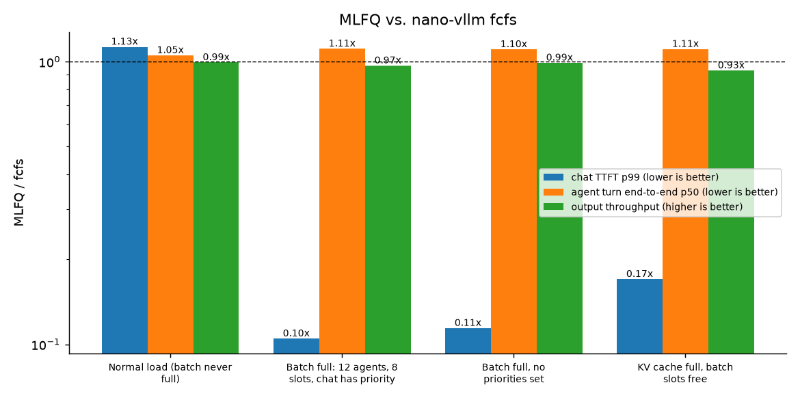
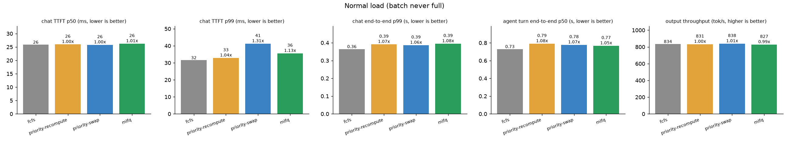
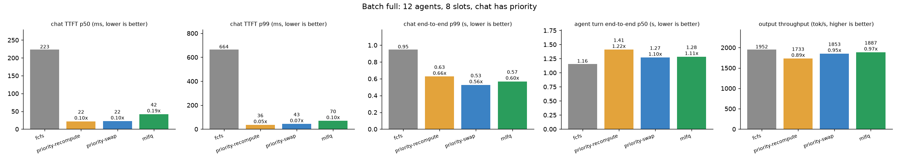
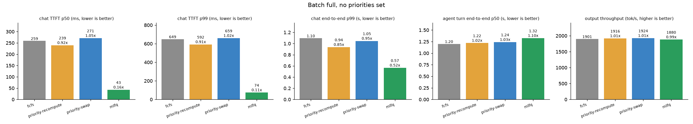
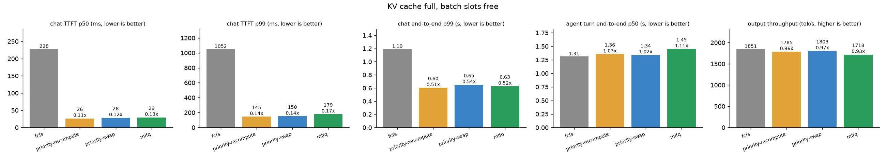

# Saturation-triggered MLFQ scheduling

nano-vllm's scheduler is first-come-first-served continuous batching. That is the right
policy almost all of the time: while there are free batch slots and free KV blocks every
request is admitted as soon as it arrives, and there is nothing to reorder.

It goes wrong in one situation, described in
[vllm-project/vllm#40004](https://github.com/vllm-project/vllm/issues/40004): the batch is
full (`max_num_seqs` sequences running) and the running sequences are long, low-value work
such as agent sessions generating thousands of tokens. A new interactive request now waits
until one of them finishes, which can be minutes. Sorting the waiting queue by priority does
not help, because the request is already first in line; there is simply no slot.

This branch keeps fcfs behaviour under normal conditions and switches to a multi-level
feedback queue (MLFQ) only once the batch is saturated.

## Policies

`scheduling_policy` selects one of:

| policy | rank (lower is better) | notes |
|---|---|---|
| `fcfs` (default) | arrival order | nano-vllm's original scheduler |
| `priority` | `priority` | strict tiers, `starvation_steps` boosts long-waiting requests one tier |
| `mlfq` | `(level, priority)` | the policy this document is about |

All three cap `running` at `max_num_seqs`, as vLLM does. (Upstream nano-vllm only caps
the number of sequences per step, so extra sequences could sit in `running` holding KV
without being decoded.)

## When does it preempt?

| situation | what happens |
|---|---|
| free slots, free KV | nothing; requests are admitted best rank first |
| free slots, KV full at admission | the request waits, exactly like fcfs |
| **batch full** and a waiting request ranks strictly better than a runner | after `preempt_after_steps` steps of waiting, the worst-ranked runners are evicted, just enough to free one slot and the newcomer's KV blocks. All or nothing |
| KV full during decode | as in fcfs (and vLLM), one runner is evicted; here it is the worst-ranked one instead of the newest |

Guards against churn: equal ranks never evict each other, a runner is protected for its
first `min_resident_steps` decode steps, sequences already in the current step's batch are
never evicted, and nobody is evicted for a newcomer that would not fit anyway.

## MLFQ

Four levels by default, set by `mlfq_level_tokens=(1024, 4096, 8192)`. The level follows a
request's size, prompt plus generated tokens:

| level | holds |
|---|---|
| 0 | up to 1024 tokens |
| 1 | up to 4096 |
| 2 | up to 8192 |
| 3 | everything longer |

* New requests go in by size: a short chat starts at level 0, a 5000-token prompt at level 2.
* While the batch has room, levels change nothing. A request that grows past 1024 tokens
  keeps running exactly as in fcfs.
* Once the batch is full and new requests keep coming, a newcomer evicts the runner in the
  lowest level (the longest one), so long agent sessions make way for short requests. With
  swap the evicted request keeps its KV cache in host memory.
* Aging: a waiting request moves up one level every `aging_steps` scheduler steps, and a
  promoted request gets that level's whole token band again before it can drop. When the
  batch has free slots, waiting requests are admitted best level first, so evicted ones
  come back as soon as there is room.
* Priorities are optional. `SamplingParams.priority` breaks ties within a level;
  `mlfq_priority_scale` widens the bands of important requests (scale 2 lets priority -1
  hold 2048 tokens in level 0); `mlfq_max_levels={0: 1}` keeps priority 0 at level 1 or above.

Because it uses only the size it can see, MLFQ needs no output-length prediction and no
priorities: it already tells a short chat from a 6000-token agent context.

## Preemption: recompute or swap

`preemption_mode`:

* `recompute`: drop the victim's KV blocks; it re-prefills when resumed (prefix caching may
  save part of it).
* `swap`: copy the victim's KV blocks into a pinned host-memory pool of `swap_space` GiB and
  copy them back on resume. The copies are queued on the compute stream before the forward
  pass, so they are ordered against it without extra synchronization. Falls back to
  recompute if the pool is full.
* `auto`: swap only victims with at least `swap_min_tokens` cached tokens. Short contexts
  are about as cheap to recompute as to copy, so host memory is kept for long agent
  contexts, which are the usual victims.

## Recommended configuration

```python
LLM(model, scheduling_policy="mlfq", mlfq_level_tokens=(1024, 4096, 8192),
    aging_steps=200, min_resident_steps=4, preempt_after_steps=8,
    preemption_mode="auto", swap_space=4, swap_min_tokens=256)
llm.generate(prompts, SamplingParams(priority=0))    # lower value = more important
```

## Results

One H100 PCIe, Qwen3-0.6B, `GPU=3 scripts/run_priority_bench.sh all` (60 s of arrivals per run,
CUDA graphs on). Raw numbers are in `results/priority_bench.jsonl`; regenerate the charts with
`python -m benchmarks.plot`.

Workload (`benchmarks/priority_bench.py`): closed-loop agent sessions (300-600 token start,
128-384 tokens generated per turn, a 50-150 token tool result appended, reset at 2048 tokens,
priority 1) plus open-loop Poisson chat (32-128 token prompts, 16-128 tokens out, priority 0).
The benchmark uses smaller MLFQ levels to match: `mlfq_level_tokens=(256, 512, 1024)`, so chat
always stays in level 0 and agents sit in levels 1-3.

| scenario | setup |
|---|---|
| normal | 32 slots, 4 agents, 1 chat/s: the batch never fills |
| batch-cap | 8 slots, 12 agents, 4 chat/s, plenty of KV: the vllm#40004 case |
| no-priority | as batch-cap, but chat and agents have the same priority |
| kv-pressure | 64 slots but only 40 KV blocks (10k tokens) |

`mlfq` is the recommended configuration below with the smaller levels, swap for contexts of
128+ tokens.



| config | chat TTFT p50 | chat TTFT p99 | chat e2e p99 | agent e2e p50 | agent turns | tok/s | preempt | swap out/in | recomputed tok |
|---|---|---|---|---|---|---|---|---|---|
| normal/fcfs | 26 ms | 32 ms | 0.36 s | 0.73 s | 192 | 834 | 0 | 0/0 | 0 |
| normal/priority-recompute | 26 ms | 33 ms | 0.39 s | 0.79 s | 187 | 831 | 0 | 0/0 | 0 |
| normal/priority-swap | 26 ms | 41 ms | 0.39 s | 0.78 s | 186 | 838 | 0 | 0/0 | 0 |
| normal/mlfq | 26 ms | 36 ms | 0.39 s | 0.77 s | 187 | 827 | 0 | 0/0 | 0 |
| batch-cap/fcfs | 223 ms | 664 ms | 0.95 s | 1.16 s | 430 | 1952 | 0 | 0/0 | 0 |
| batch-cap/priority-recompute | 22 ms | 36 ms | 0.63 s | 1.41 s | 370 | 1733 | 187 | 0/0 | 233795 |
| batch-cap/priority-swap | 22 ms | 43 ms | 0.53 s | 1.27 s | 404 | 1853 | 180 | 180/180 | 0 |
| batch-cap/mlfq | 42 ms | 70 ms | 0.57 s | 1.28 s | 406 | 1887 | 218 | 218/218 | 0 |
| no-priority/fcfs | 259 ms | 649 ms | 1.10 s | 1.20 s | 423 | 1901 | 0 | 0/0 | 0 |
| no-priority/priority-recompute | 239 ms | 592 ms | 0.94 s | 1.22 s | 420 | 1916 | 0 | 0/0 | 0 |
| no-priority/priority-swap | 271 ms | 659 ms | 1.05 s | 1.24 s | 416 | 1924 | 0 | 0/0 | 0 |
| no-priority/mlfq | 43 ms | 74 ms | 0.57 s | 1.32 s | 394 | 1880 | 229 | 229/229 | 0 |
| kv-pressure/fcfs | 228 ms | 1052 ms | 1.19 s | 1.31 s | 397 | 1851 | 70 | 0/0 | 64025 |
| kv-pressure/priority-recompute | 26 ms | 145 ms | 0.60 s | 1.36 s | 386 | 1785 | 80 | 0/0 | 96738 |
| kv-pressure/priority-swap | 28 ms | 150 ms | 0.65 s | 1.34 s | 387 | 1803 | 151 | 151/151 | 0 |
| kv-pressure/mlfq | 29 ms | 179 ms | 0.63 s | 1.45 s | 368 | 1718 | 101 | 101/101 | 0 |






### What it shows

* **Normal load costs nothing.** MLFQ tracked levels (501 demotions) but never preempted;
  throughput is within 1% of fcfs and the latency differences are a few milliseconds, within
  run-to-run noise.
* **Full batch: chat TTFT p99 drops from 664 ms to 70 ms (9.5x)** for 3% less throughput.
  Strict priority gets chat in slightly faster (it does not wait `preempt_after_steps`), but
  with recompute it loses 11% throughput and re-prefills 234k tokens; swap is what makes
  preemption cheap.
* **No priorities set: only MLFQ helps.** Priority scheduling degenerates to fcfs (nothing to
  rank), while MLFQ still cuts chat TTFT p99 from 649 ms to 74 ms and chat end-to-end p99 in
  half, purely from request size, at 1% throughput.
* **The price is paid by the long requests**: agent turns take about 10% longer at the median.
  That is the intended trade, and aging keeps it bounded.
* **KV pressure with free slots**: no admission preemption by design. Chat still gets in faster
  (p99 1052 ms -> 179 ms) because the queue is ordered and decode-time eviction picks the
  largest sequence instead of the newest; that costs 7% throughput here, since the largest
  sequence is also the most expensive to swap. `priority-swap` is the better trade-off when
  KV, not batch slots, is the bottleneck.

Single 60 s run per configuration, so differences of a few percent are within noise.
The `torch._dynamo hit config.recompile_limit` warning in the logs comes from upstream
nano-vllm's compiled RMSNorm and also appears with fcfs.

### Correctness

* `tests/test_priority_scheduling.py` (CPU): preemption rules, swap bookkeeping, MLFQ levels,
  aging, and a randomized workload checking block accounting invariants across all policies.
* `tests/gpu/test_swap_gpu.py`: swapping blocks out and back is bit-exact, and a request that
  is swapped out mid-generation produces exactly the same greedy tokens as an undisturbed run.
