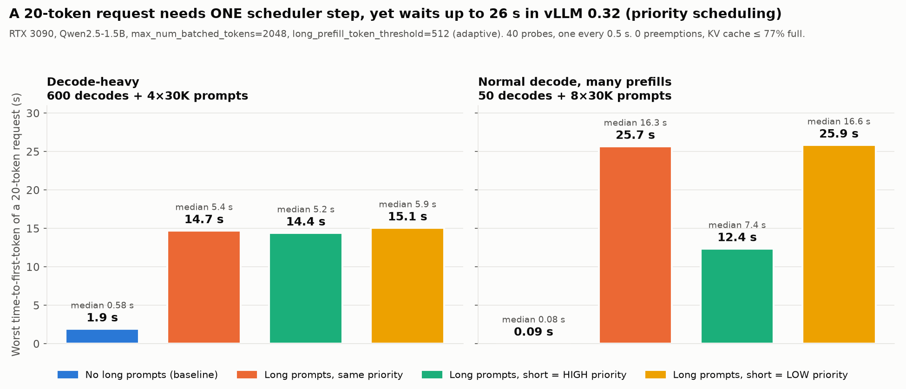
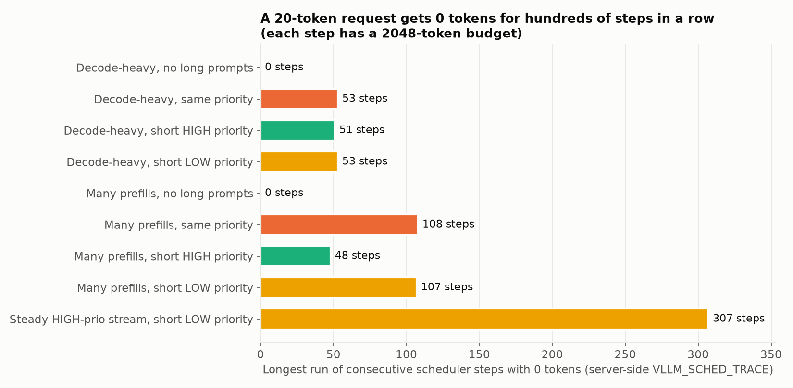
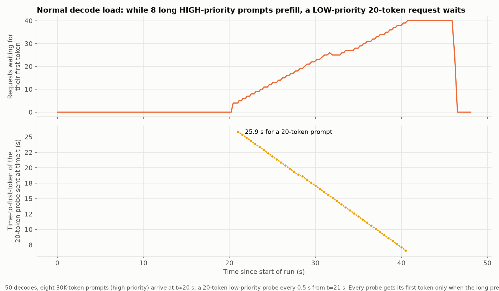
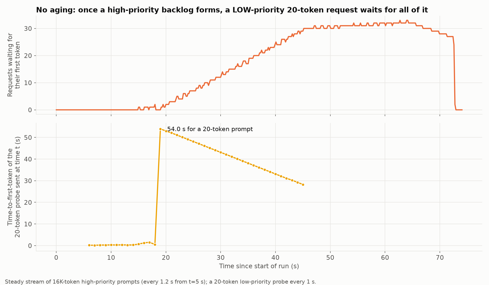
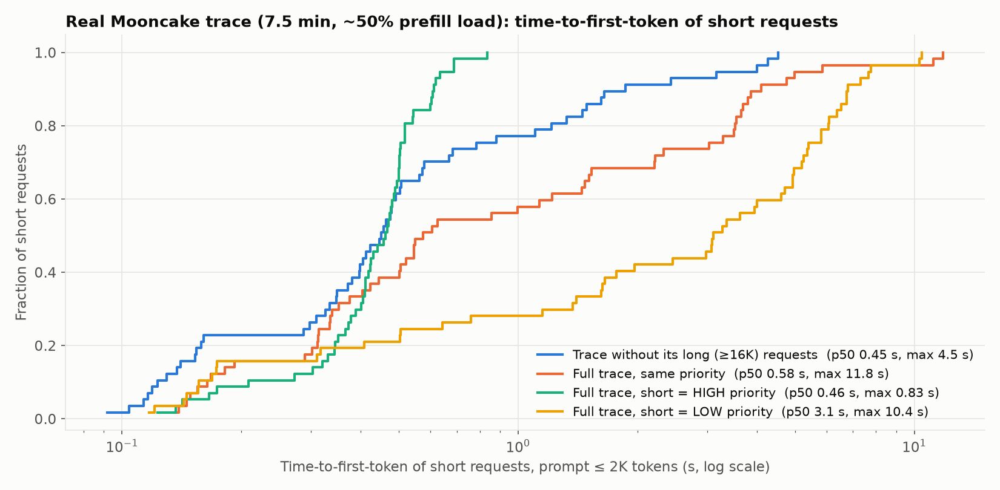

# Prefill starvation in vLLM chunked prefill (priority scheduling)

**Problem:** in vLLM's V1 scheduler, a request with a *tiny* prompt can wait **tens of
seconds** for its first token while long prompts are being prefilled, even though it needs a
single scheduler step and the GPU has free memory. Priority scheduling does not protect it:
a **high**-priority short request still waits behind **low**-priority long prefills that were
admitted first, and a **low**-priority short request has no upper bound on its wait (no aging),
even though serving it would cost the high-priority work < 1 % of one step ([details](#a-small-request-should-get-a-chance-even-at-low-priority)).

Measured on a real GPU with vLLM **v0.32.0** (this branch = upstream v0.32.0 + an opt-in
scheduler trace), `--scheduling-policy priority`:

| Scenario (RTX 3090, Qwen2.5-1.5B) | 20-token request, worst time-to-first-token | Longest run of steps with **0 tokens** |
|---|---|---|
| 600 decodes, no long prompts (baseline) | 1.9 s | 0 |
| 600 decodes + 4×30K prompts, same priority | **14.7 s** | 53 |
| 600 decodes + 4×30K low-prio prompts, short = **high** priority | **14.4 s** | 51 |
| 600 decodes + 4×30K high-prio prompts, short = low priority | **15.1 s** | 53 |
| 50 decodes, no long prompts (baseline) | 0.09 s | 0 |
| 50 decodes + 8×30K prompts, same priority | **25.7 s** (≈280× baseline) | 108 |
| 50 decodes + 8×30K low-prio prompts, short = **high** priority | **12.4 s** | 48 |
| 50 decodes + 8×30K high-prio prompts, short = low priority | **25.9 s** | 107 |
| steady stream of high-prio 16K prompts, short = low priority | **54.0 s** | 307 |

In every run with long prompts: **0 preemptions and the KV cache ≤ 77 % full**. This is purely a scheduling
effect, not a memory or capacity problem of the short request (it needs 20 of the 2048 tokens
in each step's budget).




## A small request should get a chance even at LOW priority

Priority should decide who goes first when requests compete for the same budget. It should
not let a request that needs a negligible slice of one step wait for the whole high-priority
backlog. A 20-token prompt uses **< 1 % of a single step's 2048-token budget**. Serving it
costs the high-priority work almost nothing:

| GPU run (20-token probes at **low** priority, long prompts at **high** priority) | Probe tokens vs. high-priority prefill tokens | Low-priority probe: median / worst time-to-first-token | Longest 0-token run |
|---|---|---|---|
| 50 decodes + 8×30K prompts | 800 vs 240,000 (**0.33 %**) | 16.6 s / **25.9 s** (baseline 0.09 s) | 107 steps |
| 600 decodes + 4×30K prompts | 800 vs 120,000 (**0.67 %**) | 5.9 s / **15.1 s** (baseline 1.9 s) | 53 steps |
| steady high-prio stream of 16K prompts | 800 vs 800,000 (**0.10 %**) | 35.1 s / **54.0 s** | 307 steps |
| real Mooncake trace, ~50 % load (short = prompt ≤ 2K) | n/a | 3.1 s / 10.4 s (baseline 0.45 s / 4.5 s) | 62 steps |
| same trace, overloaded (0.35× speed) | n/a | **183 s / 327 s** | 1,550 steps |

Giving every one of those probes its 20 tokens would have delayed the high-priority prompts by
well under 1 % of their prefill work, i.e. less than one ~10–50 ms step. Instead the probes waited
tens of seconds to minutes. vLLM has no rule that bounds this:

* the WAITING queue is strict `(priority, arrival)` order, so a low-priority request is only
  admitted when no higher-priority request is waiting *and* budget is left after the RUNNING
  requests;
* there is **no aging** (waiting time never raises priority) and **no size awareness** (a
  20-token request is treated like a 30K-token one);
* the chunk cap (`long_prefill_token_threshold`) limits how much *each* long prefill takes, but
  with enough of them running they still take the whole budget.

**Desired property for a fix:** a request whose remaining prefill is tiny (e.g. ≤ a few hundred
tokens) is served within a bounded number of steps *regardless of its priority*. The cost to
higher-priority work stays bounded by that small token count. Priority then orders the large
work, not the trivially small one.

## Why it happens (vLLM v0.32.0 source, unchanged in v0.33.0 and `main` as of 2026-11-04)

`Scheduler.schedule()` in [`vllm/v1/core/sched/scheduler.py`](../vllm/v1/core/sched/scheduler.py):

1. **One token budget per step** (`max_num_batched_tokens`) is shared by decodes and prefill
   chunks. There is no separate prefill budget.
2. **RUNNING requests are served first, in admission order**, until the budget is gone
   (`while req_index < len(self.running) and token_budget > 0`, line 666). The running list is
   *not* ordered by priority.
3. **Per-request chunk cap** `long_prefill_token_threshold`. With
   `--long-prefill-token-threshold-adaptive` the cap is
   `max(threshold, max_num_batched_tokens // (num_running + num_waiting))` (line 661). The
   divisor counts *every* request, including decodes, so under load the fair share is tiny and
   the cap collapses to the static floor (512 here). So the "adaptive" cap behaves exactly like
   the static one when it matters.
4. Hence once `⌈(budget − decodes) / cap⌉` long prefills are running, **they take the whole
   budget every step** and nothing is left for the waiting queue. A new short request gets
   0 tokens until one of them finishes its prompt.
5. **Priority only orders the WAITING queue** (`PriorityRequestQueue`, heap on
   `(priority, arrival_time, request_id)`) and picks the **KV-preemption** victim
   (`max(self.running, key=(priority, arrival_time))`, line 804). An exhausted *token budget*
   never preempts or pauses a lower-priority running prefill. So a high-priority short request
   is stuck behind low-priority long prefills that were admitted before it (**priority
   inversion**).
6. **No aging**: a low-priority request's position never improves with waiting time, so under
   a steady high-priority load its wait is unbounded.

Pausing a running *partial prefill* for one step costs nothing (its KV stays on the GPU), so
serving the 20-token request first would add ~1 step to a 30K prompt that takes ~60 steps.

## How it was measured

* **Server:** `vllm serve` from this branch on one RTX 3090 (24 GB), `--load-format dummy`
  (Qwen2.5-1.5B architecture, random weights — compute and scheduling are identical),
  `--max-model-len 32768 --max-num-batched-tokens 2048 --long-prefill-token-threshold 512
  --long-prefill-token-threshold-adaptive --scheduling-policy priority
  --no-enable-prefix-caching --gpu-memory-utilization 0.85` ([`gpu/serve.sh`](gpu/serve.sh)).
* **Server-side evidence:** `VLLM_SCHED_TRACE=<file>` (commit 2 of this branch) logs every
  scheduler step: each prefill chunk per request, number of decodes, the effective cap, how
  many first-token-waiting requests got 0 tokens, preemptions and KV usage.
  [`gpu/analyze.py`](gpu/analyze.py) counts, per request, the steps between its arrival and its
  last prefill chunk in which it received 0 tokens.
* **Client:** [`gpu/replay_client.py`](gpu/replay_client.py) streams `/v1/completions`
  requests (token-id prompts, `ignore_eos`, per-request `priority`) at their arrival times and
  records time-to-first-token.
* **Workloads:** [`gpu/build_micro.py`](gpu/build_micro.py): background decoders (200-token
  prompt, 4000 output tokens), long prompts (30K tokens) arriving at t≈20 s, and a 20-token
  probe every 0.5 s. Real-trace workloads: [`gpu/build_workloads.py`](gpu/build_workloads.py)
  from the public **Mooncake** (Kimi, FAST'25) and **Azure LLM inference** traces.

### Simulator, validated bit-exact against vLLM

[`sim.py`](sim.py) re-implements the token-allocation logic of `Scheduler.schedule()`;
[`validate_vllm.py`](validate_vllm.py) drives the **real** vLLM `Scheduler` on CPU (no model)
with the same scenarios and compares `num_scheduled_tokens` per request per step:
**28/28 scenarios identical** (FCFS and priority, static and adaptive cap, 0/300/768 decodes,
KV-pressure runs with preemption). [`vllm_harness.py`](vllm_harness.py) replays workloads
through the real `Scheduler` on CPU for fast what-if studies.

## Timelines




## Real trace (Mooncake conversation trace)

Public **Mooncake** conversation trace (Kimi, FAST'25): real arrival times and prompt/output
lengths, a 450 s window replayed at 0.2× speed (≈50 % of the 3090's prefill capacity), prompts
capped at 32K. "Short" = prompt ≤ 2K tokens (57 requests); "long" = ≥ 16K tokens (51).

| Short requests (≤ 2K tokens) | median TTFT | worst TTFT | longest 0-token run |
|---|---|---|---|
| Trace without its long requests (baseline) | 0.45 s | 4.5 s | 29 steps |
| Full trace, same priority | 0.58 s | **11.8 s** (2.6× baseline) | 67 steps |
| Full trace, short = **high** priority | 0.46 s | 0.83 s | 3 steps |
| Full trace, short = **low** priority | **3.1 s** (7× baseline) | **10.4 s** | 62 steps |



At this moderate load the effect is mostly in the tail. Here high priority *does* protect short
requests, because long prompts are rarely already running when a short one arrives, so it can
jump the waiting queue. The inversion appears when several long prefills are already running,
which is what the micro scenarios above isolate.

**Same trace at 0.35× speed (prefill-overloaded, `results/gpu/prio2048_ds_*`):** everyone queues,
so these runs are not a fairness result. But they show the no-aging case clearly: with short
requests at **low** priority, their median TTFT was **183 s** and the worst **327 s** (1,550
consecutive steps with 0 tokens), while medium requests had a median of 27 s. With short
requests at **high** priority they stayed at a 1.8 s median (5.4 s worst).

## Caveats

* Under FCFS (and among equal priorities) the wait is **bounded**: the short request is served
  once the long prefills ahead of it finish. It is unbounded only for low-priority requests
  under a sustained high-priority load (no aging). "Starvation" above means multi-second to
  minute-long head-of-line blocking of one-step requests.
* A 1.5B model on a 3090 is fast and limited to 32K context. With 100K+ prompts or larger
  models the waits scale up proportionally (the validated simulator predicts ≈84 s for a
  20-token prompt behind two 100K prompts with 768 decodes at budget 1024).
* Prefix caching was disabled so every prompt is fully prefilled.

## Reproduce

Everything is scripted in [`reproduce.sh`](reproduce.sh) (run from this branch; the repo root
is the vLLM v0.32.0 source with the trace patch, installed editable):

```bash
prefill_starvation/reproduce.sh setup      # venv: editable vLLM 0.32.0 + official cu129 kernels, chart venv, model config
prefill_starvation/reproduce.sh data       # download the public Mooncake + Azure traces
prefill_starvation/reproduce.sh validate   # CPU only: simulator vs REAL vLLM Scheduler, expects 28/28 OK
GPU=1 prefill_starvation/reproduce.sh gpu  # one GPU: priority-policy server, all scenarios, analysis (~1.5 h)
prefill_starvation/reproduce.sh charts     # results/charts/*.png
```

Requirements: NVIDIA driver ≥ 575 (CUDA 12.9), one GPU with ≥ 24 GB, `uv`, `curl`, `rsync`.
Every job runs under [`tools/safe_run.sh`](tools/safe_run.sh): hard RAM cap (cgroup), host-RAM
watchdog, `nice`/`taskset`, graceful SIGTERM timeout, `nvidia-smi` health check before/after.

| File | Purpose |
|---|---|
| `gpu/serve.sh` | start `vllm serve` (dummy weights, priority policy, trace on) on one GPU |
| `gpu/build_micro.py` | micro workloads (decodes + 30K prompts + 20-token probes, priorities) |
| `gpu/build_workloads.py`, `workloads.py` | workloads from the Mooncake / Azure traces |
| `gpu/replay_client.py` | timed streaming client, records time-to-first-token |
| `gpu/run_and_analyze.sh`, `gpu/run_dataset.sh` | run one scenario + join with the server trace |
| `gpu/analyze.py`, `gpu/probe_report.py` | per-request zero-token steps from `VLLM_SCHED_TRACE` |
| `sim.py`, `validate_vllm.py`, `vllm_harness.py`, `micro.py` | CPU simulator, bit-exact validation vs vLLM, real-Scheduler replay |
| `charts.py` | the figures |
| `results/gpu/` | raw client results, per-request analysis, server trace (`trace_prio2048.jsonl.gz`) |

## Next

Fix candidates (to be evaluated with the same harness): let a short or high-priority prefill
take budget from running partial prefills (pausing them is free), shortest-remaining-prefill
ordering with aging, and a small reserved budget slice for new requests.
