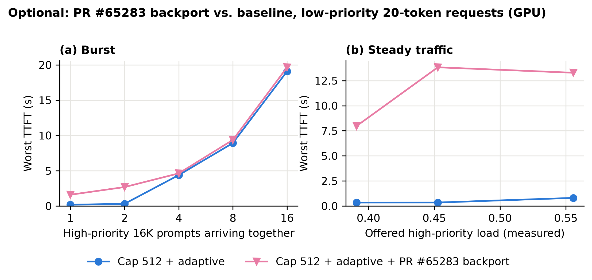

# Optional: PR #65283 backport (experimental, not part of the main analysis)

[vllm-project/vllm#65283](https://github.com/vllm-project/vllm/pull/65283), head `4960575`, is
**open and unmerged**. It adds `--priority-prefill-budget-cap`: while a higher-priority request
waits for its first 16 output tokens, every lower-priority prefill is given 0 tokens in the
step. The goal is faster first tokens for *high*-priority requests.

This folder keeps one exploratory measurement: what that hold does to the *low*-priority short
requests studied in the main analysis. It is kept apart because:

* the PR targets upstream `main`, and what we measured is **our backport to v0.32.0**, which may
  not match upstream behaviour;
* the main analysis is about stock vLLM.

## The backport

[`pr65283_backport_v0.32.diff`](pr65283_backport_v0.32.diff) applies on top of this branch's
baseline. It contains the PR's scheduler, config, request-queue and metrics changes, its test
file, and our study hooks: runtime control keys `pcap`, `pcap_tokens`, `mpp` and a trace field
`hold`. Changes needed for v0.32.0:

* an empty `async_kv_waiting` queue (v0.32.0 has no async KV-load queue);
* the v0.32.0 prefix-cache-hit bound (`num_tokens - 1`);
* `KVCacheBlock.pool` is a direct reference in v0.32.0, not a weakref;
* the PR's `SchedulerStats` and Prometheus logger fields.

**Checks**

* The PR's own test file passes 81/90 ([log](results/pr65283_own_tests.txt)). 7 failures need
  upstream-only APIs (async KV-connector loads, test-helper arguments). 2 are prefix-cache cases
  in its KV make-room path, which we did not use.
* With the cap disabled, the patched scheduler matches stock schedules on 28/28 validation
  scenarios ([log](results/validation_pr65283_port_disabled.txt)).

## What was measured

* **GPU** (session 1, RTX 3090, same setup as the main analysis): cap 512 + adaptive with and
  without `pcap`, in the same server session with the backport applied. That gives burst
  N = 1–16, and steady traffic at offered load 0.39–0.56 only. Capacity in that session was
  12,959 tokens/s, and the workloads were sized for a lower assumed capacity.
* **CPU** (real scheduler, constant 180 ms step): the same settings.
* Only the budget-cap mode was tested. Make-room preemption was off
  (`max_priority_preemptions_per_step = 0`) and prefix caching was off. Its effect on
  high-priority requests was not measured.

| | cap 512 + adaptive | + PR #65283 backport |
|---|---|---|
| GPU burst, 1 high-priority prompt: worst low-priority TTFT | 0.18 s | 1.6 s |
| GPU steady traffic, offered load 0.39–0.56: worst low-priority TTFT | 0.35–0.81 s | 8.0–13.8 s |
| CPU steady traffic, load 0.5 / 0.99 (session-1 workloads): longest 0-token run | 6 / 116 steps | 140 / 345 steps |
| CPU, 8 high-priority prompts kept in flight, 20,000 steps | never served | never served |

The server trace labels most of the extra zero-token steps as a priority hold: 89–2,206
probe-steps per run, at times when budget was still available.

**Limitations.** This is a single session, one configuration per point, and an unmerged PR
backported by us. It shows the hold can delay low-priority short prompts; it says nothing about
the PR's intended benefit.

## Files

* `pr65283_backport_v0.32.diff`: the backport; apply with `git apply` at the repository root.
* `results/gpu_runs/`: processed per-run data, session 1 (`adaptive` and `pr65283`).
* `results/raw_client/`: client records of those runs.
* `results/sched_trace_pr65283_and_adaptive.jsonl.gz`: the server trace for those runs.
* `results/cpu_sweep_session1.json`: CPU results for both settings.
* `make_figure.py` writes `figures/pr65283_comparison.{png,pdf}`.

**To re-run:** `git apply` the patch. Then use the main GPU scripts with the control value
`{"thr": 512, "adaptive": true, "pcap": true}` in `$VLLM_SCHED_CTRL`.
